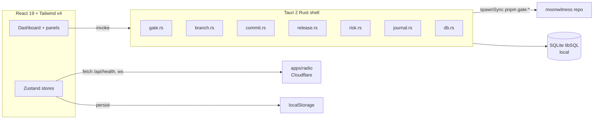

# Scope — Desktop Companion Plan

> Status: **implemented** (Phase 1–4). This document is the source of truth for
> Scope's architecture, module boundaries, radio integration contract, and
> milestones. It is owned by the Scope agent; other agents should treat
> `apps/scope/**` as its territory.

## 1. Identity

- **Name**: Scope
- **Tagline**: _see the signal, scope the work._
- **Meaning**: dual-meaning — oscilloscope (radio signal) + engineering scope.
- **Package**: `@moonwitness/scope` (private, in `apps/scope`).

## 2. Problem

Engineering context is scattered across terminal, gate, branch, release, and the
public `apps/radio`. There is no single window that summarizes "what is safe to
push, did the gate pass, what is the release state, is radio up" with exit-code
fidelity. Scope is that window.

## 3. Architecture (local-first / offline)



Principles:

- **Local-first**: every core feature works with no network. Radio is optional.
- **Offline**: radio connector degrades to "offline" + cached last health; never
  errors, never fakes green.
- **Exit-code fidelity**: all child processes use `spawnSync`/`Command::output`;
  the real exit code is read and returned. No `|| true`, no piping to `tail`.
- **No fake green**: BLOCKED is reported as BLOCKED, not PASS.
- **Minimal deps**: Tauri + React + Zustand + libSQL. No Redux, no query layer.

### Directory layout

```
apps/scope/
  src/
    main.tsx, App.tsx, styles.css
    components/   Dashboard, GatePanel, BranchGuard, CommitComposer,
                  ReleaseRadar, RiskMapPanel, DoctorPanel, JournalPanel,
                  SignalViz, Dock
    stores/       workspace, gate, branch, commit, release, risk, journal, radio
    db/           index.ts (initScopeDb), migrations.ts
  src-tauri/
    src/
      main.rs, lib.rs
      commands/   gate, branch, commit, release, risk, journal, db, git
    tauri.conf.json, Cargo.toml, build.rs, icons/
  package.json, tsconfig.json, eslint.config.mjs, vite.config.ts, index.html
  BRANDING.md
```

## 4. Modules

| Module          | Command / Store                                                     | Responsibility                                                                           |
| --------------- | ------------------------------------------------------------------- | ---------------------------------------------------------------------------------------- |
| Gate runner     | `scope_run_gate` / `stores/gate.ts`                                 | Spawn `pnpm gate:quick\|local\|push\|release\|doctor`, stream events, preserve exit code |
| Branch guard    | `scope_branch_guard` / `stores/branch.ts`                           | Block push to `main`/`master`, show topology, ahead/behind                               |
| Commit composer | `scope_validate_commit`, `scope_suggest_scope` / `stores/commit.ts` | Enforce Conventional Commits, suggest scope from changed packages                        |
| Release radar   | `scope_release_radar` / `stores/release.ts`                         | Manifest drift, changelog entry, tag availability                                        |
| Risk map        | `scope_risk_map` / `stores/risk.ts`                                 | Dirty/stale packages, migration status, env drift                                        |
| Doctor          | reuses gate runner (`gate:doctor`) / `DoctorPanel.tsx`              | Structured doctor output + auto-fix suggestions                                          |
| Daily journal   | `scope_daily_journal` / `stores/journal.ts`                         | Commits since midnight, summary                                                          |
| Radio connector | `stores/radio.ts`                                                   | HTTP health + WebSocket live signal, offline fallback                                    |
| Signal viz      | `SignalViz.tsx`                                                     | Oscilloscope-style canvas waveform                                                       |
| Workspace       | `scope_git_status` / `stores/workspace.ts`                          | Root, branch, dirty, ahead/behind                                                        |

### Local database

SQLite via `@moonwitness/orm` (libSQL driver). Migrations in
`src/db/migrations.ts`, table `001_init`:

- `audit_log` — every user action (run gate, commit, push, release, radio fetch)
- `gate_runs` — gate name, outcome, duration, steps
- `radio_health` — online, latency, listeners, error
- `daily_journal` — per-date summary

DB path resolved by `scope_db_path` (Tauri app data dir); falls back to
`:memory:` in browser dev.

## 5. Radio integration contract (client-side only)

Scope consumes the public radio app; it does **not** modify `apps/radio`.

| Endpoint                                                  | Method    | Use                                |
| --------------------------------------------------------- | --------- | ---------------------------------- |
| `https://moonwitness-radio.bjo163.workers.dev/api/health` | GET       | online status, latency, listeners  |
| `wss://moonwitness-radio.bjo163.workers.dev/ws`           | WebSocket | live signal (frequency, amplitude) |

Behavior:

- Health checked on connect and on demand; 5s timeout.
- WebSocket connects opportunistically; malformed messages ignored.
- Offline: `online=false`, `wsConnected=false`, cached last health shown; no error
  thrown to the user.

## 6. Milestones

| Phase                 | Scope                                                               | Exit criteria                                            |
| --------------------- | ------------------------------------------------------------------- | -------------------------------------------------------- |
| 1 — Foundation        | Scaffold Tauri 2 + React, wire to workspace/Turbo, SQLite schema    | `gate:quick` PASS, `cargo check` PASS, `vite build` PASS |
| 2 — Core local        | Gate runner, branch guard, commit composer, release radar, risk map | each command compiles + panel renders                    |
| 3 — Awareness         | Doctor, daily journal, dashboard composition, dock                  | all panels composed in Dashboard                         |
| 4 — Signal & branding | Radio connector, signal viz, branding, gate integration             | radio health + WS live, `GATECHECK.md` updated           |

## 7. Ownership & boundaries

- **Owned**: `apps/scope/**` (planning + implementation).
- **Consumed read-only**: `apps/radio` public URL (client-side contract only).
- **Not touched**: `services/*`, `cp/arsy/**`, `apps/api/**` (Agents 1 & 2),
  `packages/ui/**` and web redesign (Agent 4). Shared packages/config changed
  only when strictly necessary (e.g. `turbo.json` scope tasks, `.prettierignore`
  `src-tauri/target`).

## 8. Build & gate notes

- Rust build is **not** in `gate:local` default (toolchain heavy). Separate task:
  `pnpm --filter @moonwitness/scope scope:build` (requires Rust + Tauri CLI).
- `gate:quick` / `gate:local` include scope via workspace-wide `pnpm lint` /
  `pnpm typecheck` filters.
- Windows target: WebView2 (present on Win10/11); `tauri build` emits `.msi`/`.nsis`.

## 9. Status

All 16 planned todos are implemented and verified:

- `pnpm gate:quick` — 7/7 PASS (format, lint, typecheck across `@moonwitness/*`).
- `cargo check` in `apps/scope/src-tauri` — clean (exit 0).
- `pnpm --filter @moonwitness/scope build` — Vite build succeeds.

Pre-existing, unrelated: `apps/web` typecheck error in
`src/components/command-center/index.tsx` (not caused by Scope).
